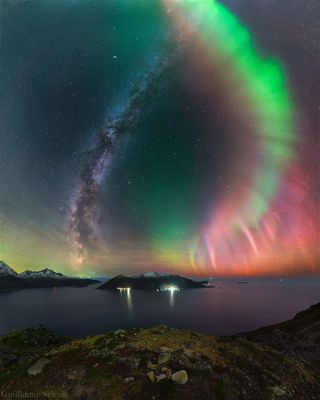
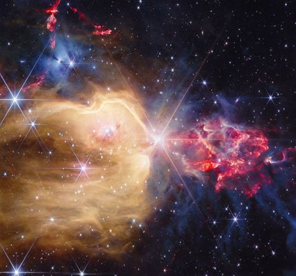
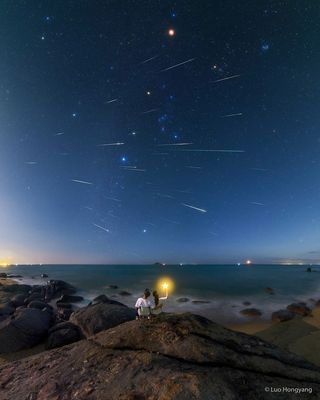
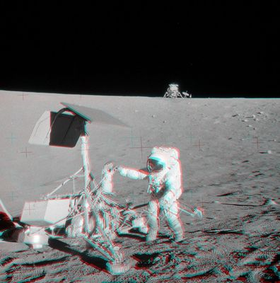
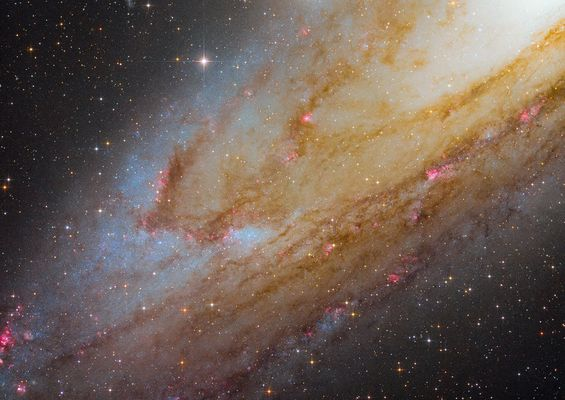
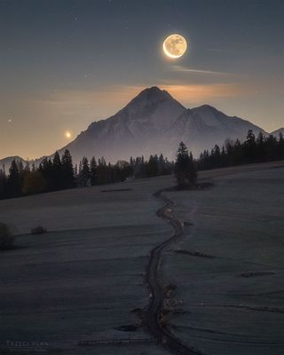
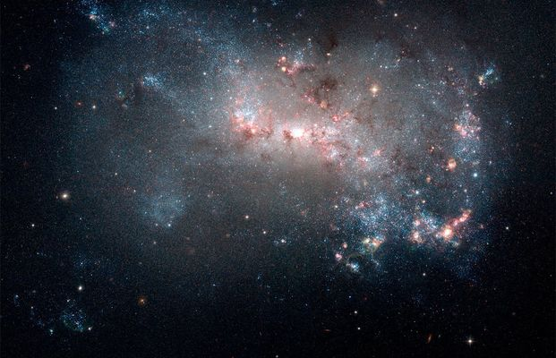

# NASAPic

用 Python 抓取 NASA 的 [Astronomy Picture of the Day](https://science.nasa.gov/apod/)。每天发布的内容可能是一张天文照片，也可能是一段视频。可以在这里看最近几期，也可以把图片下载到本地。

## NASA 每日天文图 · 最近 7 期

<!-- apod-week:start -->
<!-- apod-date: 2026-11-17 -->

<table>
<thead><tr><th scope="col">日期</th><th scope="col">预览</th><th scope="col">APOD</th></tr></thead>
<tbody>
<tr><th scope="row">2026-11-17</th><td><a href="https://assets.science.nasa.gov/content/dam/science/cds/apod/apod/2026/november/GalaxyVsAurora_Scheib_960.jpg/jcr:content/renditions/cq5dam.web.1280.1280.jpeg"></a></td><td><a href="https://science.nasa.gov/image-article/apod-2026-november-17-milky-way-versus-aurora/"><strong>Milky Way versus Aurora</strong></a><br><a href="https://assets.science.nasa.gov/content/dam/science/cds/apod/apod/2026/november/GalaxyVsAurora_Scheib_960.jpg/jcr:content/renditions/cq5dam.web.1280.1280.jpeg">查看大图</a> · 960 × 1200<br><sub>Guillaume Scheib</sub></td></tr>
<tr><th scope="row">2026-11-16</th><td><a href="https://assets.science.nasa.gov/content/dam/science/missions/webb/science/2026/10/weic2620a.jpg/jcr:content/renditions/cq5dam.web.1280.1280.jpeg"></a></td><td><a href="https://science.nasa.gov/image-article/apod-2026-november-16-ngc-7129-star-formation-with-jets-from-webb/"><strong>NGC 7129: Star Formation with Jets from Webb</strong></a><br><a href="https://assets.science.nasa.gov/content/dam/science/missions/webb/science/2026/10/weic2620a.jpg/jcr:content/renditions/cq5dam.web.1280.1280.jpeg">查看大图</a> · 1280 × 1194<br><sub>NASA, ESA, CSA, STScI, JWST; Processing: A. Pagan (STScI)</sub></td></tr>
<tr><th scope="row">2026-11-15</th><td><a href="https://assets.science.nasa.gov/content/dam/science/cds/apod/apod/2026/november/Leonids2022_Hongyang_2880.jpg/jcr:content/renditions/cq5dam.web.1280.1280.jpeg"></a></td><td><a href="https://science.nasa.gov/image-article/apod-2026-november-15-leonid-meteors-through-orion/"><strong>Leonid Meteors Through Orion</strong></a><br><a href="https://assets.science.nasa.gov/content/dam/science/cds/apod/apod/2026/november/Leonids2022_Hongyang_2880.jpg/jcr:content/renditions/cq5dam.web.1280.1280.jpeg">查看大图</a> · 1024 × 1280<br><sub>Luo Hongyang</sub></td></tr>
<tr><th scope="row">2026-11-14</th><td><a href="https://assets.science.nasa.gov/dynamicimage/assets/science/cds/apod/apod/2026/november/KF-ApAn48-7133-4.jpg?w=2181&amp;h=2200&amp;fit=clip"></a></td><td><a href="https://science.nasa.gov/image-article/apod-2026-november-14-apollo-12-and-surveyor-3/"><strong>Apollo 12 and Surveyor 3</strong></a><br><a href="https://assets.science.nasa.gov/dynamicimage/assets/science/cds/apod/apod/2026/november/KF-ApAn48-7133-4.jpg?w=2181&amp;h=2200&amp;fit=clip">查看大图</a> · 2179 × 2200<br><sub>Apollo 12, Alan Bean - Stereo Image Copyright: Kevin Frank</sub></td></tr>
<tr><th scope="row">2026-11-13</th><td><a href="https://assets.science.nasa.gov/content/dam/science/cds/apod/apod/2026/november/Andromeda_closeupCruz4096.jpg/jcr:content/renditions/cq5dam.web.1280.1280.jpeg"></a></td><td><a href="https://science.nasa.gov/image-article/apod-2026-november-13-ngc-206-and-the-star-clouds-of-andromeda/"><strong>NGC 206 and the Star Clouds of Andromeda</strong></a><br><a href="https://assets.science.nasa.gov/content/dam/science/cds/apod/apod/2026/november/Andromeda_closeupCruz4096.jpg/jcr:content/renditions/cq5dam.web.1280.1280.jpeg">查看大图</a> · 1280 × 906<br><sub>David Cruz</sub></td></tr>
<tr><th scope="row">2026-11-12</th><td><a href="https://assets.science.nasa.gov/content/dam/science/cds/apod/apod/2026/november/conjunction-bubak.jpg/jcr:content/renditions/cq5dam.web.1280.1280.jpeg"></a></td><td><a href="https://science.nasa.gov/image-article/apod-2026-november-12-moon-venus-and-spica-meet/"><strong>Moon, Venus and Spica Meet</strong></a><br><a href="https://assets.science.nasa.gov/content/dam/science/cds/apod/apod/2026/november/conjunction-bubak.jpg/jcr:content/renditions/cq5dam.web.1280.1280.jpeg">查看大图</a> · 1023 × 1280<br><sub>Włodzimierz Bubak</sub></td></tr>
<tr><th scope="row">2026-11-11</th><td><a href="https://assets.science.nasa.gov/content/dam/science/missions/hubble/galaxies/irregular/NGC%204449.jpg/jcr:content/renditions/cq5dam.web.1280.1280.jpeg"></a></td><td><a href="https://science.nasa.gov/image-article/apod-2026-november-11-ngc-4449-small-galaxy-big-impact/"><strong>NGC 4449: Small Galaxy, Big Impact</strong></a><br><a href="https://assets.science.nasa.gov/content/dam/science/missions/hubble/galaxies/irregular/NGC%204449.jpg/jcr:content/renditions/cq5dam.web.1280.1280.jpeg">查看大图</a> · 1280 × 825<br><sub>NASA, ESA, A. Aloisi (STScI/ESA), and the Hubble Heritage (STScI/AURA)-ESA/Hubble Collaboration</sub></td></tr>
</tbody>
</table>
<!-- apod-week:end -->

图集按 NASA 发布日期倒序排列。点击缩略图可打开大图，点击标题可看 NASA 的原文说明与署名。视频期会链接到原文，有封面时也会显示预览。图片尺寸来自实际文件，长边达到 3840 像素且短边达到 2160 像素时会标出 4K。

## 空间天气日报 · 最近 7 天

<!-- space-weather:start -->

| 日期（UTC） | 最高 Kp | X 射线耀斑 | 最强耀斑 |
| --- | ---: | ---: | ---: |
| 2026-11-17 | 3.00 | 16 | M1.7 |
| 2026-11-16 | 1.33 | 13 | C5.4 |
| 2026-11-15 | 2.00 | 8 | C1.5 |
| 2026-11-14 | 1.67 | 6 | C4.4 |
| 2026-11-13 | 1.33 | 6 | C5.5 |
| 2026-11-12 | 1.67 | 19 | C7.1 |
| 2026-11-11 | 2.67 | 11 | M1.8 |

<!-- space-weather:end -->

[空间天气 Action](https://github.com/LittleCabbage-00/NASAPic/actions/workflows/space-weather.yml) 每天北京时间 **12:47** 更新。日期按 UTC 计算，最高 Kp 取当天 8 个三小时时段的最大值。太阳耀斑按 X 射线峰值时间归入对应日期，同一事件有多份报告时采用最高级别。[查看历史数据](data/space-weather.json) · [NOAA Kp 指数](https://services.swpc.noaa.gov/products/noaa-planetary-k-index.json) · [NOAA 事件报告](https://services.swpc.noaa.gov/json/edited_events.json)

## 本地下载

需要 Python 3.10 或更新版本。运行以下命令会回查最近 5 期，把图片保存到 `downloads/`，已有的图片会跳过。

```shell
python -m pip install -r requirements.txt
python apod.py download
```

只下载指定日期时可以加 `--date`，用 `--output` 指定保存目录。

```shell
python apod.py download --date 2026-11-15 --output downloads
```

## 自动更新

GitHub Actions 每天北京时间 **20:37** 检查 NASA Science 的 APOD 数据。有变化时提交 README 和最近 7 期的缩略图。也可以在 [Actions](https://github.com/LittleCabbage-00/NASAPic/actions/workflows/apod.yml) 手动运行，无需配置 API Key。

图片及视频的署名与使用条款见 NASA 的各期原文和 [APOD FAQ](https://apod.nasa.gov/rjn/apod/ap_faq.html)。
