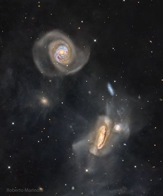
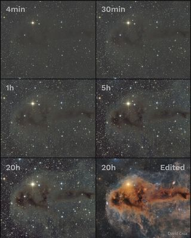
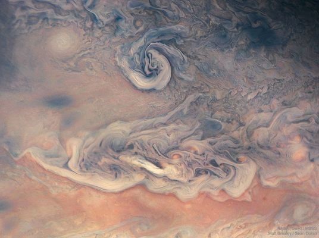
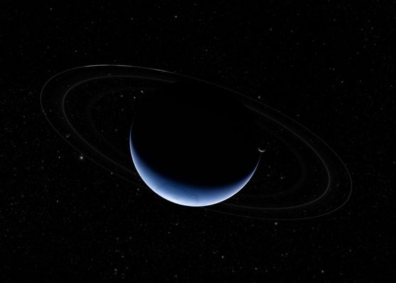
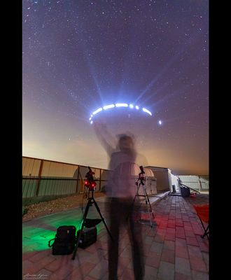
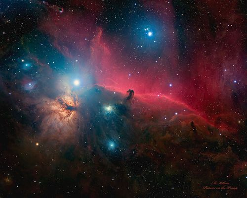
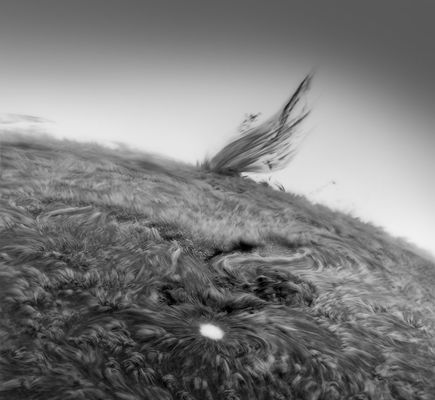

# NASAPic

用 Python 抓取 NASA 的 [Astronomy Picture of the Day](https://science.nasa.gov/apod/)。每天发布的内容可能是一张天文照片，也可能是一段视频。可以在这里看最近几期，也可以把图片下载到本地。

## NASA 每日天文图 · 最近 7 期

<!-- apod-week:start -->
<!-- apod-date: 2026-11-24 -->

<table>
<thead><tr><th scope="col">日期</th><th scope="col">预览</th><th scope="col">APOD</th></tr></thead>
<tbody>
<tr><th scope="row">2026-11-24</th><td><a href="https://assets.science.nasa.gov/dynamicimage/assets/science/cds/apod/apod/2026/november/NGC7771group_Marinoni_1179.jpg?w=1179&amp;h=1422&amp;fit=clip"></a></td><td><a href="https://science.nasa.gov/image-article/apod-2026-november-24-galaxies-battle-in-the-ngc-7771-group/"><strong>Galaxies Battle in the NGC 7771 Group</strong></a><br><a href="https://assets.science.nasa.gov/dynamicimage/assets/science/cds/apod/apod/2026/november/NGC7771group_Marinoni_1179.jpg?w=1179&amp;h=1422&amp;fit=clip">查看大图</a> · 1179 × 1422<br><sub>Roberto Marinoni</sub></td></tr>
<tr><th scope="row">2026-11-23</th><td><a href="https://assets.science.nasa.gov/dynamicimage/assets/science/cds/apod/apod/2026/november/Ldn1251Comparison_Cruz_2160.jpg?w=2160&amp;h=2700&amp;fit=clip"></a></td><td><a href="https://science.nasa.gov/image-article/apod-2026-november-23-the-emergence-of-dark-nebula-lynds-1251/"><strong>The Emergence of Dark Nebula Lynds 1251</strong></a><br><a href="https://assets.science.nasa.gov/dynamicimage/assets/science/cds/apod/apod/2026/november/Ldn1251Comparison_Cruz_2160.jpg?w=2160&amp;h=2700&amp;fit=clip">查看大图</a> · 2160 × 2700<br><sub>David Cruz</sub></td></tr>
<tr><th scope="row">2026-11-22</th><td><a href="https://assets.science.nasa.gov/dynamicimage/assets/science/cds/apod/apod/2026/november/JupiterSwirls_JunoBrealey_3709.jpg?w=3709&amp;h=2772&amp;fit=clip"></a></td><td><a href="https://science.nasa.gov/image-article/apod-2026-november-22-swirls-and-colors-on-jupiter-from-juno/"><strong>Swirls and Colors on Jupiter from Juno</strong></a><br><a href="https://assets.science.nasa.gov/dynamicimage/assets/science/cds/apod/apod/2026/november/JupiterSwirls_JunoBrealey_3709.jpg?w=3709&amp;h=2772&amp;fit=clip">查看大图</a> · 3709 × 2770<br><sub>NASA, Juno, SwRI, MSSS; Processing &amp; License: Matt Brealey, Seán Doran</sub></td></tr>
<tr><th scope="row">2026-11-21</th><td><a href="https://assets.science.nasa.gov/dynamicimage/assets/science/cds/apod/apod/2026/november/Neptune-South-Pole-Voyager-2_2327x1670.jpg?w=2327&amp;h=1670&amp;fit=clip"></a></td><td><a href="https://science.nasa.gov/image-article/apod-2026-november-21-voyagers-neptune/"><strong>Voyager&#x27;s Neptune</strong></a><br><a href="https://assets.science.nasa.gov/dynamicimage/assets/science/cds/apod/apod/2026/november/Neptune-South-Pole-Voyager-2_2327x1670.jpg?w=2327&amp;h=1670&amp;fit=clip">查看大图</a> · 2327 × 1669<br><sub>Assembly/Processing - Rolf Olsen, Data - Voyager 2, NASA Planetary Data System</sub></td></tr>
<tr><th scope="row">2026-11-20</th><td><a href="https://assets.science.nasa.gov/dynamicimage/assets/science/cds/apod/apod/2026/november/IMG_4364N_Kyriazis.jpg?w=3898&amp;h=4724&amp;fit=clip"></a></td><td><a href="https://science.nasa.gov/image-article/apod-2026-november-20-v-g-r/"><strong>V-G-R</strong></a><br><a href="https://assets.science.nasa.gov/dynamicimage/assets/science/cds/apod/apod/2026/november/IMG_4364N_Kyriazis.jpg?w=3898&amp;h=4724&amp;fit=clip">4K 图像</a> · 3897 × 4724<br><sub>Apostolos Kyriazis</sub></td></tr>
<tr><th scope="row">2026-11-19</th><td><a href="https://assets.science.nasa.gov/dynamicimage/assets/science/cds/apod/apod/2026/november/Horsehead_Nebula_Killion.jpg?w=6000&amp;h=4800&amp;fit=clip"></a></td><td><a href="https://science.nasa.gov/image-article/apod-2026-november-19-the-horsehead-and-flame-nebulas/"><strong>The Horsehead and Flame Nebulas</strong></a><br><a href="https://assets.science.nasa.gov/dynamicimage/assets/science/cds/apod/apod/2026/november/Horsehead_Nebula_Killion.jpg?w=6000&amp;h=4800&amp;fit=clip">4K 图像</a> · 6000 × 4800<br><sub>Mark E. Killion</sub></td></tr>
<tr><th scope="row">2026-11-18</th><td><a href="https://assets.science.nasa.gov/dynamicimage/assets/science/cds/apod/apod/2026/november/solar_M_flare.jpg?w=3000&amp;h=2759&amp;fit=clip"></a></td><td><a href="https://science.nasa.gov/image-article/apod-2026-november-18-an-m-class-solar-flare/"><strong>A Medium-Sized Solar Flare</strong></a><br><a href="https://assets.science.nasa.gov/dynamicimage/assets/science/cds/apod/apod/2026/november/solar_M_flare.jpg?w=3000&amp;h=2759&amp;fit=clip">查看大图</a> · 3000 × 2759<br><sub>Mario Cogo</sub></td></tr>
</tbody>
</table>
<!-- apod-week:end -->

图集按 NASA 发布日期倒序排列。点击缩略图可打开大图，点击标题可看 NASA 的原文说明与署名。视频期会链接到原文，有封面时也会显示预览。图片尺寸来自实际文件，长边达到 3840 像素且短边达到 2160 像素时会标出 4K。

## 空间天气日报 · 最近 7 天

<!-- space-weather:start -->

| 日期（UTC） | 最高 Kp | X 射线耀斑 | 最强耀斑 |
| --- | ---: | ---: | ---: |
| 2026-11-23 | 1.67 | 6 | B4.7 |
| 2026-11-22 | 2.33 | 3 | B4.2 |
| 2026-11-21 | 2.67 | 5 | B5.2 |
| 2026-11-20 | 2.00 | 8 | C9.7 |
| 2026-11-19 | 5.00 | 13 | M2.4 |
| 2026-11-18 | 3.33 | 14 | C7.3 |
| 2026-11-17 | 3.00 | 16 | M1.7 |

<!-- space-weather:end -->

[空间天气 Action](https://github.com/LittleCabbage-00/NASAPic/actions/workflows/space-weather.yml) 每天北京时间 **12:47** 更新。日期按 UTC 计算，最高 Kp 取当天 8 个三小时时段的最大值。太阳耀斑按 X 射线峰值时间归入对应日期，同一事件有多份报告时采用最高级别。[查看历史数据](data/space-weather.json) · [NOAA Kp 指数](https://services.swpc.noaa.gov/products/noaa-planetary-k-index.json) · [NOAA 事件报告](https://services.swpc.noaa.gov/json/edited_events.json)

## 本地下载

需要 Python 3.10 或更新版本。运行以下命令会回查最近 5 期，把图片保存到 `downloads/`，已有的图片会跳过。

```shell
python -m pip install -r requirements.txt
python apod.py download
```

只下载指定日期时可以加 `--date`，用 `--output` 指定保存目录。

```shell
python apod.py download --date 2026-11-15 --output downloads
```

## 自动更新

GitHub Actions 每天北京时间 **20:37** 检查 NASA Science 的 APOD 数据。有变化时提交 README 和最近 7 期的缩略图。也可以在 [Actions](https://github.com/LittleCabbage-00/NASAPic/actions/workflows/apod.yml) 手动运行，无需配置 API Key。

图片及视频的署名与使用条款见 NASA 的各期原文和 [APOD FAQ](https://apod.nasa.gov/rjn/apod/ap_faq.html)。
